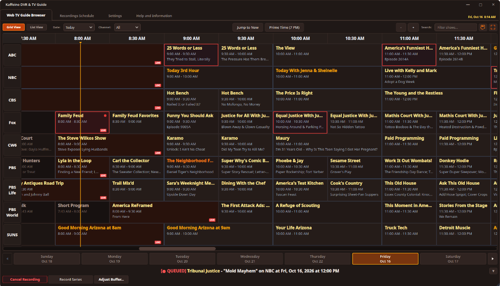
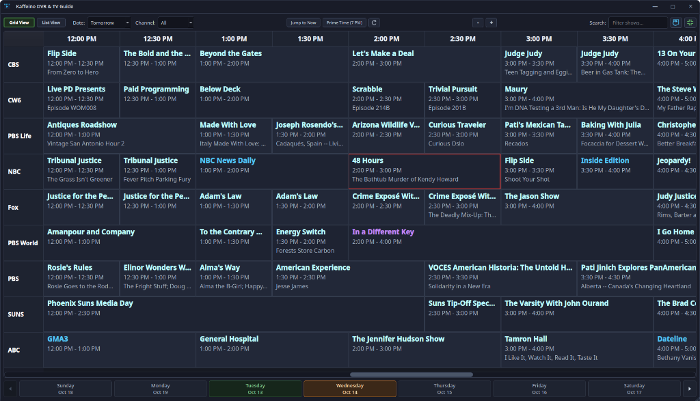
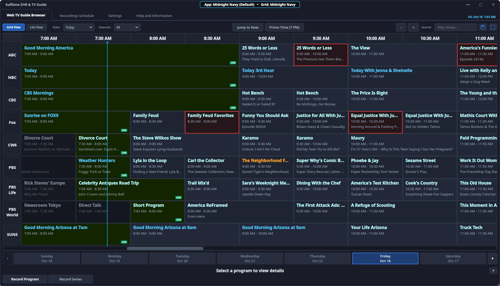
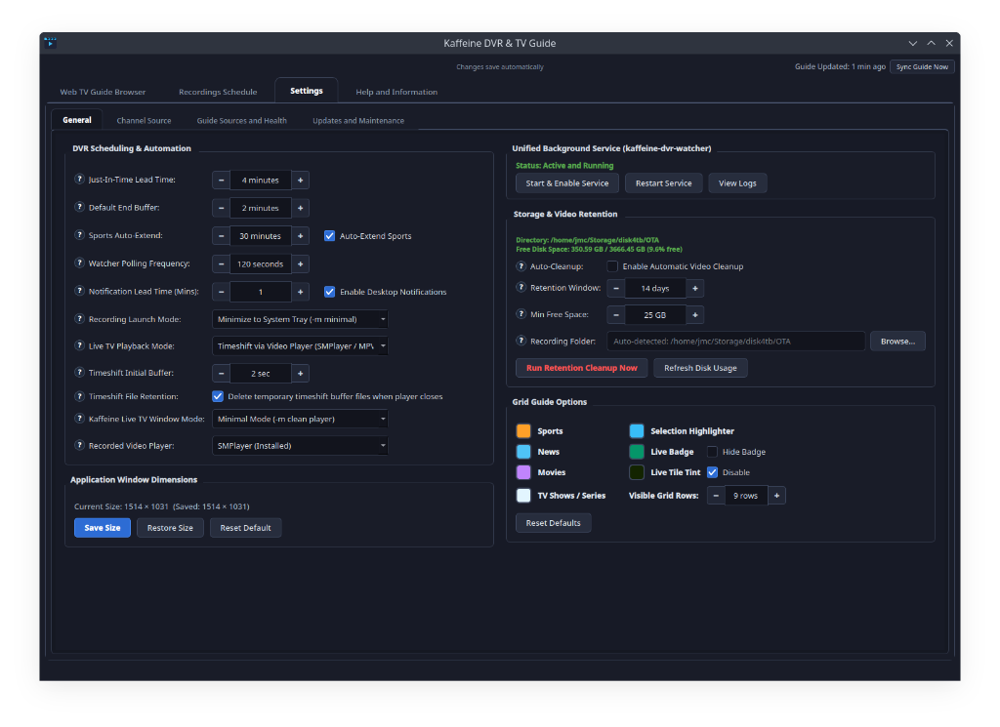
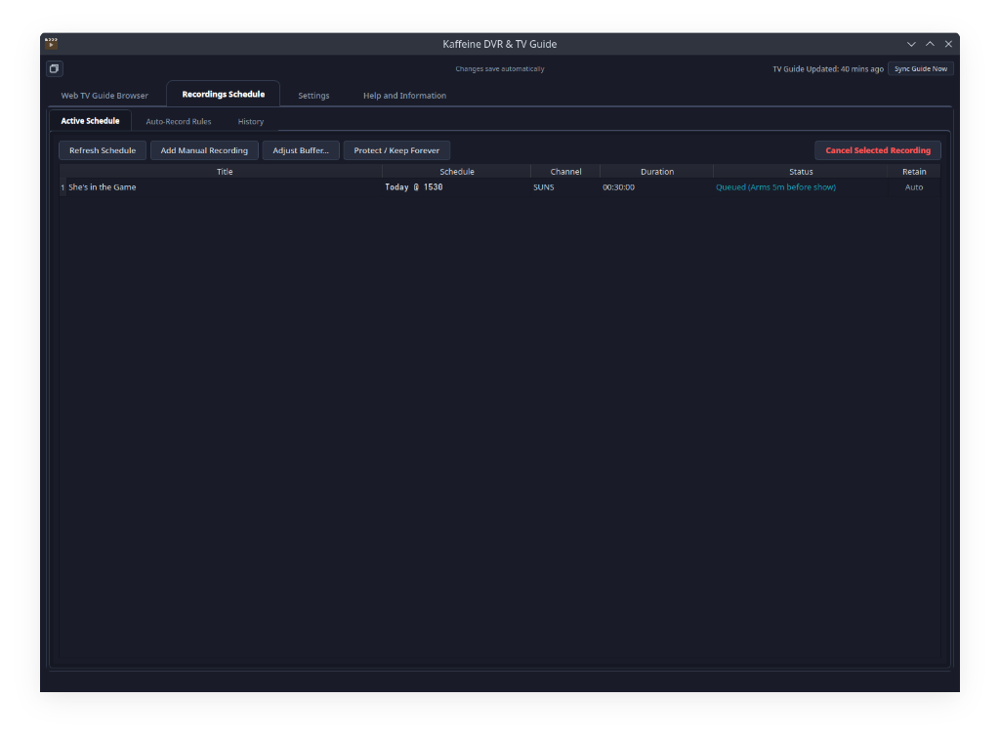
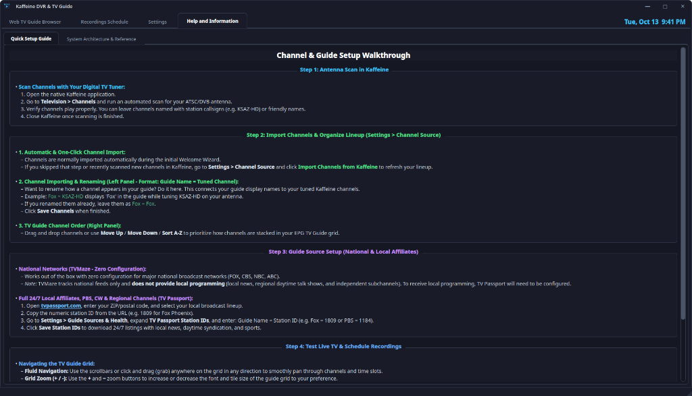

# Kaffeine-DVR-TV-Guide

Modern TV Guide browser, auto-record series scheduler, and Just-In-Time (JIT) DVR recording daemon for Kaffeine on Linux.

> [!NOTE]
> This is an independent, non-commercial open-source companion tool. It is not affiliated with, maintained by, or endorsed by the KDE Project or the official Kaffeine developers.

---

## Overview

Kaffeine is a powerful digital TV viewer for KDE and Linux desktop environments, but managing recording timers natively presents two common challenges:
1. Native Kaffeine timers inhibit system power management, blocking automated or manual system restarts and shutdowns while timers are pending.
2. In many broadcast markets, electronic program guide (EPG) data over-the-air is sparse, incomplete, or requires continuous manual tuning.

**Kaffeine-DVR-TV-Guide** solves both problems:
- **Zero-Block Power Operations:** Scheduled recordings are held in an external queue database (`recordings_queue.sqlite`). Kaffeine stays completely clean with zero active timers until minutes before showtime.
- **Just-In-Time (JIT) Dispatching:** A lightweight systemd user background service monitors the queue. When a broadcast is about to begin (e.g. 5 minutes before airtime), it launches Kaffeine minimized and arms the timer over D-Bus automatically.
- **Independent Systemd Daemon:** The background service (`kaffeine-dvr-watcher.service`) runs completely detached from the GUI as a `systemd --user` service. You can close the TV Guide window anytime, and the background daemon stays running 24/7 in the background (and restarts automatically upon login/reboot).
- **Comprehensive EPG Providers:**
  - **TVMaze Cloud API (Free & Automatic)**
  - **TV Passport (Web Station Directory)**
  - **Free Hybrid Mode**
  - **Custom XMLTV Feeds**
  - **Schedules Direct**
- **Dual-Mode TV Guide (Traditional EPG Grid & Searchable List):**
  - **Traditional Grid Layout**
  - **Intuitive Mouse Grab-and-Drag Scrolling**
  - **Genre Color Coding**
  - **Smart Timeline Navigation**
  - **Double-Click to Watch & Smart State**
  - **Adaptive "Watch Live / Tune Channel" Actions**
  - **Direct Startup Launch**
- **Remote Web Companion (Mobile & LAN Web App):**
  - **Touch-Friendly EPG Grid & List Views**
  - **One-Click Remote Recording from Phone or Tablet**
  - **In-Browser Video Playback & Streaming (RFC 7233 Seekable)**
  - **Remote DVR Queue & History Management**
  - **Optional Salted SHA-256 Authentication for Tailscale / LAN**
  - **Zero Extra Dependencies (Built with Standard Library HTTP Server)**
- **Configurable Recording End Buffers (Post-Roll Padding):**
  - **Global Post-Roll Buffer**
  - **Sports Broadcast Auto-Extend**
  - **Per-Rule Custom Overrides**
- **Series Auto-Record Rules**
- **Automated Video Retention & Storage Management:**
  - **Age Retention**
  - **Low-Disk Auto-Purge**
  - **Active Recording & Sidecar Safety**

---

## Screenshots

| Traditional EPG Grid TV Guide View |
|:---:|
| [](docs/screenshots/guide_grid.png) |
| [](docs/screenshots/guide_grid_2.png) |

| Mix and Match Themes - Grid and App themes Separately |
|:---:|
| [](docs/screenshots/kaffeine_dvr_themes.gif) |

| General Settings |
|:---:|
| [](docs/screenshots/general_settings.png) |

| Recordings Schedule (DVR Queue & History) | Help and Information Setup Walkthrough |
|:---:|:---:|
| [](docs/screenshots/recordings_schedule.png) | [](docs/screenshots/help_guide.png) |

---

## Installation

### Option 1: AppImage (Recommended - No Setup Required)

The AppImage is completely self-contained. **No Python, PyQt6, or package installation is needed** (all libraries and dependencies are bundled inside).

- **Latest Available AppImage**: [Download TV.Guide.DVR.Kaffeine v0.8.15 AppImage](https://github.com/PlasmaDrifter/TV.Guide.DVR.Kaffeine/releases/tag/v0.8.15)
- **Native Packages**: Standalone `.deb` (Debian/Ubuntu/Mint) and `.rpm` (Fedora/Nobara/RHEL) packages are also available under [GitHub Releases](https://github.com/PlasmaDrifter/TV.Guide.DVR.Kaffeine/releases/tag/v0.8.15).
- **All Releases & Source Code**: [View All GitHub Releases](https://github.com/PlasmaDrifter/TV.Guide.DVR.Kaffeine/releases)

1. Download the AppImage file from the link above.
2. Make it executable and run:
```bash
chmod +x TV.Guide.DVR.Kaffeine-*.AppImage
./TV.Guide.DVR.Kaffeine-*.AppImage
```

> **Tip:** You can also drop it into your favorite AppImage manager such as **AppManager** or **Gear Lever** for automatic desktop menu integration.

---

### Option 2: Automated Installation (From Source)

Use this method if you prefer installing directly into your user Python environment and registering systemd user services.

#### Prerequisites (For Source Installation Only)
- Python 3.9 or newer with `pip`
- Kaffeine (`kaffeine`) installed on your system
- Optional desktop tools: `notify-send` (for notifications), `kdotool` or `xdotool` (for window minimization)

*(Note: Python dependencies such as PyQt6 are downloaded and installed automatically by `install.sh`)*

#### Install Script
Clone the repository and run the automated installer:
```bash
git clone https://github.com/PlasmaDrifter/TV.Guide.DVR.Kaffeine.git
cd TV.Guide.DVR.Kaffeine
./install.sh
```
The script automatically:
1. Installs the Python package with appropriate flags (e.g. `--break-system-packages` where required).
2. Installs the desktop menu launcher into `~/.local/share/applications/`.
3. Installs, enables, and starts the systemd background watcher service (`kaffeine-dvr-watcher.service`).

For local development or editable mode, pass the `-e` flag:
```bash
./install.sh -e
```

### Uninstallation
To remove Kaffeine DVR:
```bash
./uninstall.sh
```
To also purge user configuration and cached database files:
```bash
./uninstall.sh --purge
```

### In-App Updates
You can check for and apply updates directly inside the application under **Settings > Updates and Maintenance**:
- **Automatic Monthly Checks**: Disabled by default. When enabled, Kaffeine DVR checks once every 30 days and displays a green notification badge in the top header with a dismissal button.
- **One-Click Update**: Click **Check for Updates Now** and **Install Update Now** to update and restart without needing terminal commands.

---

## Configuration & Guide Sources

### 1. Channel Source, Renaming & Grid Order
Navigate to **Settings > Channel Source**. Click **Import Channels from Kaffeine** to automatically read your scanned channels directly from Kaffeine's tuner database (`~/.local/share/kaffeine/sqlite.db`).

In this section, you can **rename channels** for clean guide presentation and **custom-sort the grid order** in which channels appear in your electronic program guide.

#### Channel Renaming Format:
Each channel mapping is defined as:
```text
Guide Display Name = Kaffeine Tuned Name
```
- **Guide Display Name** (Left): The user-friendly name displayed across the EPG grid, search filters, and recording rules. This is also the network name matched against EPG guide data.
- **Kaffeine Tuned Name** (Right): The exact station name stored in Kaffeine's hardware channel database so the tuner knows which physical frequency/multiplex to lock for viewing and recording.

#### 1. Initial State Upon Import (Raw Tuner Names):
When you click **Import Channels from Kaffeine**, each scanned channel initially populates as a 1:1 mapping with its raw hardware name on both sides (channel numbers, frequency multiplex prefixes, and FCC call signs):
```text
010-1 KSAZ-HD = 010-1 KSAZ-HD
012-1 KPNX-HD = 012-1 KPNX-HD
005-1 KPHO-HD = 005-1 KPHO-HD
015-1 KNXV-HD = 015-1 KNXV-HD
061-1 KASW-HD = 061-1 KASW-HD
```

#### 2. Fixed for the GUI (Clean Guide Display Names):
You then edit the left side to clean, recognizable network names for your EPG grid and guide data matching, while keeping the right side intact so Kaffeine knows which physical tuner channel to lock:
```text
Fox = 010-1 KSAZ-HD
NBC = 012-1 KPNX-HD
CBS = 005-1 KPHO-HD
ABC = 015-1 KNXV-HD
The CW = 061-1 KASW-HD
```

#### 3. If Already Renamed Inside Kaffeine:
If you already renamed or simplified your channels directly inside Kaffeine's channel editor prior to clicking import, both sides will already appear clean:
```text
Fox = Fox
NBC = NBC
CBS = CBS
ABC = ABC
The CW = CW6
```

#### Customizing Grid Sort Order:
The **TV Guide Channel Order** list allows you to arrange the exact vertical sequence of channels in the guide grid:
- Select any channel and click **Move Up** or **Move Down** to reorder (e.g. major networks first, followed by news, sports, and subchannels).
- Right-click any channel to open the context menu, or press `Delete` / `Backspace` to remove unwanted subchannels from the guide view.
- Changes are instantly saved and synchronized across both the desktop grid view and the mobile web companion.

### 2. TV Guide Sources & Zero-Configuration TVMaze
- **TVMaze (Zero Configuration Required):** Out of the box, national broadcast networks (**FOX, CBS, NBC, ABC, PBS, and The CW**) work automatically with **no accounts, no API keys, and no manual setup**. As soon as the application opens, it downloads 7 days of prime-time listings for all mapped channels.
- **National vs. Local Daytime Programming:** TVMaze catalogs national network programming (evening prime-time dramas, comedies, national sports, and network specials). However, because broadcast networks leave morning, midday, and late-afternoon blocks to local stations, **local news broadcasts, daytime syndicated talk shows, game shows, and independent local subchannels** are not part of TVMaze's national feed.

### 3. TV Passport Setup (24/7 Local Affiliate Coverage & Independent Channels)
To get complete 24/7 continuous schedules with local morning/evening news, daytime talk shows, or independent local channels:
1. Search for your local affiliate station on [tvpassport.com Lineups](https://www.tvpassport.com/index.php/lineups) by entering your ZIP/postal code.
2. Note the numeric ID from the station listings URL (for example, `/station/1812/`).
3. Under **Settings > Guide Sources > TV Passport**, enter your station mapping:
   ```text
   NBC = 1812
   ABC = 4163
   Fox = 1809
   CBS = 1813
   CW6 = 11611
   ```
4. Click **Save Station IDs**. The app verifies connectivity and triggers background synchronization immediately. In Free Hybrid mode, TV Passport automatically supersedes TVMaze for those stations to provide full 24/7 local affiliate schedules, while TVMaze continues covering any remaining national channels with zero setup and no duplicates.

### 4. Remote Web Companion & Mobile TV Guide
Kaffeine DVR includes a built-in, dependency-free HTTP server and responsive web interface designed for phones, tablets, and remote browsers:
- **Mobile & Tablet-Friendly EPG Guide**: Browse your electronic program guide on phones, tablets, or laptops. Features a two-column layout with permanently anchored channel headers on the left, smooth grab-and-drag panning, channel filtering, and genre color pills.
- **One-Click Remote Recording**: Tap **Record** on any upcoming broadcast from your phone to schedule it on your home DVR system immediately.
- **Queue & History Management**: Monitor currently recording broadcasts, view scheduled programs, and cancel queued timers remotely.
- **In-Browser Video Playback & Streaming**: Stream completed recordings directly inside your web browser with RFC 7233 HTTP Range chunking for instant video scrubbing, or download recorded video files.
- **Secure Access Control**: Optional password protection with salted SHA-256 session token authentication for secure LAN or Tailscale remote access.
- **Zero Extra Dependencies**: Powered entirely by Python's standard library HTTP server with no external web frameworks or heavy runtimes required.

#### Setup:
1. In the TV Guide desktop application, navigate to **Settings > Web Companion**.
2. Check **Enable Local / Tailscale Web Companion**.
3. (Optional) Set a custom port (default: `8088`) and configure an access password.
4. Click **Start Web Companion** or click the URL button to open it directly in your browser.

#### Headless CLI Launch:
You can also launch the web companion standalone in headless mode without opening the desktop GUI:
```bash
# Run web companion on default port (8088)
kaffeine-dvr --web

# Run on a custom port
kaffeine-dvr --web --port 8080
```

---

## CLI & Launch Usage

```bash
# Launch GUI (default when run in desktop graphical session):
kaffeine-dvr

# Show current status, cache stats, and backend health (CLI summary):
kaffeine-dvr --status

# Synchronize 7 days of TV listings
kaffeine-dvr --sync --days 7

# Evaluate auto-record rules and queue matching episodes
kaffeine-dvr --rules

# List current planned queue and active Kaffeine timers
kaffeine-dvr --list

# Run the background watcher daemon in terminal
kaffeine-dvr --watch

# Run the remote web companion server (headless)
kaffeine-dvr --web
kaffeine-dvr --web --port 8080
```

---

## Disclaimer

This is an independent, non-commercial open-source companion tool. It is not affiliated with, maintained by, or endorsed by the KDE Project or the official Kaffeine developers.

---

## License

MIT. See LICENSE for details.

---

## Community & Discussions

Got questions, setup ideas, or feedback?

* Join our subreddit at [**r/PlasmaDrifterProjects**](https://reddit.com/r/PlasmaDrifterProjects) to discuss updates, get support, and share configurations.
* Contact directly via email at [**plasmadrifter121@gmail.com**](mailto:plasmadrifter121@gmail.com).
